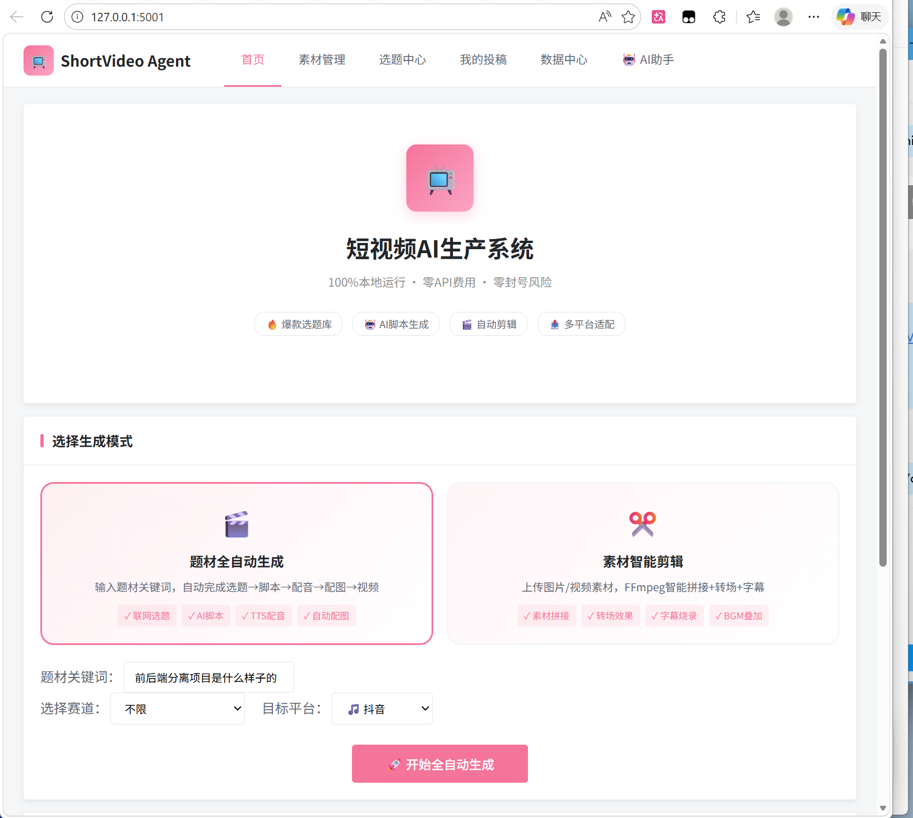
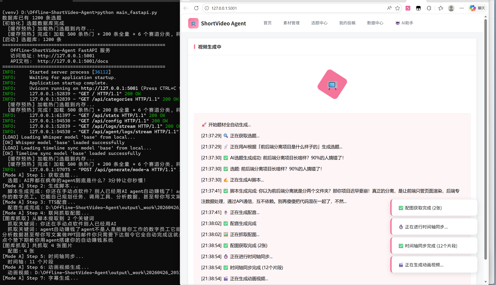
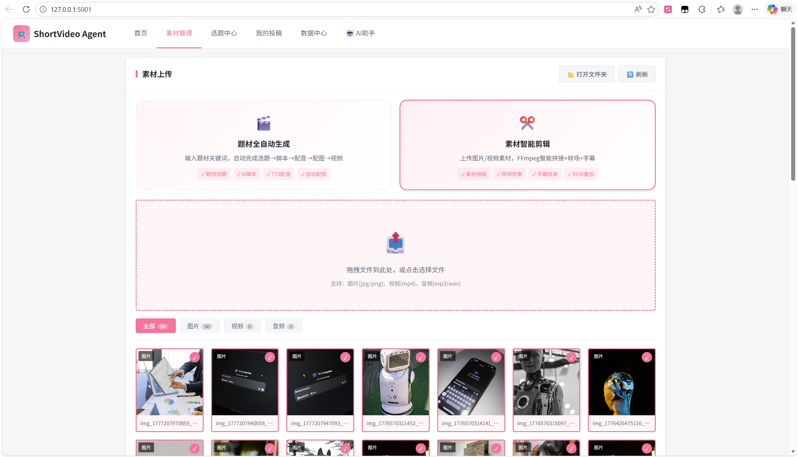
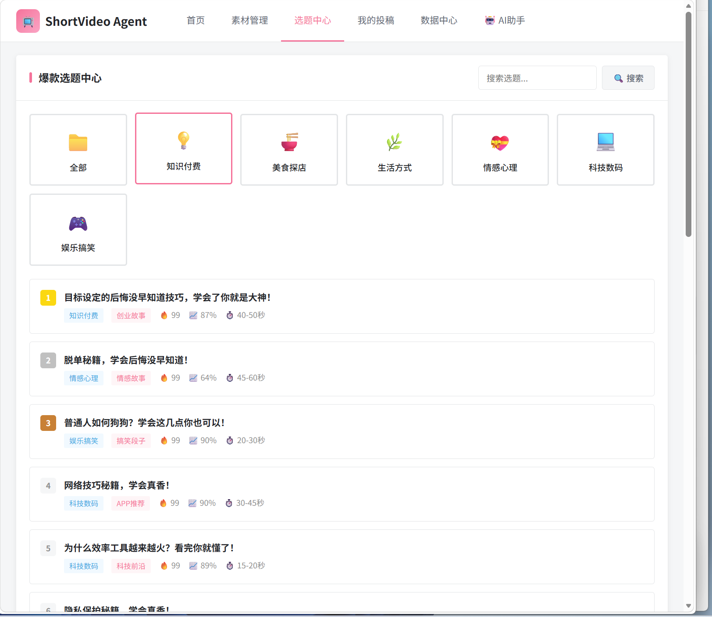

# Offline-ShortVideo-Agent

Multi-agent, fully offline short-video compiler: turns one keyword into a script, retrieves real materials, applies Ken Burns motion, burns subtitles, mixes BGM, and outputs ready-to-post Douyin / RedNote / Bilibili packages — zero API cost.

面向短视频创作、以多 Agent 协作为核心的全离线自动生成器：输入一个关键词，自动完成 AI 脚本、真实素材检索、Ken Burns 运镜、字幕烧录、背景音乐与多平台发布包 —— 零 API 成本。

[](https://www.python.org/downloads/)
[](https://opensource.org/licenses/MIT)
[](https://github.com/zhangzhanglaila/offline-short-video-agent)
[](https://ffmpeg.org/)

**Language / 语言:** [简体中文](#简体中文) | [English](#english)

---

## 简体中文

- [项目简介](#项目简介)
- [效果展示](#效果展示)
- [核心亮点](#核心亮点)
- [系统架构](#系统架构)
- [快速开始](#快速开始)
- [使用示例](#使用示例)
- [多平台适配](#多平台适配)
- [目录结构](#目录结构)
- [测试](#测试)
- [常见问题](#常见问题)
- [更新日志](#更新日志)
- [贡献指南](#贡献指南)
- [许可证](#许可证)

### 项目简介

一个基于**多 Agent 协作架构**的智能短视频自动生成系统。你只需提供一句需求，系统即可自动完成
**选题 → AI 脚本 → 素材检索 → Ken Burns 运镜 → 字幕烧录 → 背景音乐 → 多平台发布包**的全链路生产。

它解决的痛点：

- 每天想选题想到头秃，写脚本改八遍还不满意
- 花几百块买 API 额度，流量还是零
- 剪辑软件学三周，导出还是糊
- 投了十几种"自动化"工具，还是要手动一个个传素材
- 好不容易剪完，BGM 版权问题导致下架

> 当前版本 **2.1-dev**：Agent 系统（Phase 0–5）与动态化增强（D1–D6）均已完成。

[⬆ 返回顶部 / Back to top](#offline-shortvideo-agent)

### 效果展示









[⬆ 返回顶部 / Back to top](#offline-shortvideo-agent)

### 核心亮点

**全自动流水线，零人工干预**

```text
输入一个关键词 → 30 秒后 → 抖音 / 小红书 / B站 发布包已生成
```

**彻底 0 成本，不花一分钱 API（每个环节都有降级保底）**

| 环节 | 首选（免费） | 降级链 |
|------|-------------|--------|
| 脚本生成 | 本地 Ollama | 云端 DeepSeek → 规则生成 |
| TTS 配音 | Edge-TTS（微软免费） | 讯飞 → 百度 → gTTS → SAPI |
| 字幕生成 | faster-whisper（本地） | 规则算法降级 |
| 图片素材 | Pexels / Unsplash API | Pixabay → Bing 图片爬虫（无需 Key） |
| 视频剪辑 | FFmpeg（开源） | 图文模式兜底 |

**影院级动态视觉效果（D 系列增强）**

| 效果 | 说明 |
|------|------|
| Ken Burns 运镜 | 缩放 + 平移，静态图片也有电影感 |
| 文字入场动画 | 淡入 / 上浮 / 打字机，逐句吸睛 |
| 多元素分层编排 | 标题、要点、素材分层组合动态出场 |
| 丰富转场 | 淡入淡出、滑动等多种镜头衔接 |
| 视频素材背景 | 背景用真实动态视频，而非静态图 |
| 背景音乐 | 自动为成片叠加 BGM |

[⬆ 返回顶部 / Back to top](#offline-shortvideo-agent)

### 功能全景

| 能力 | 入口 | 说明 |
|------|------|------|
| 一键生成 | CLI / Web | 主题 → 脚本 → 素材 / AI 生图 → 成片 |
| 步进式流水线 | Web 首页 | 脚本可编辑 → 配音 → 素材 → 渲染 → 状态轮询 |
| 素材智能剪辑 (Mode B) | Web 首页 | 上传素材 → 拼接 / 转场 / 字幕 / BGM |
| 智能导演（人在回路） | Web `🧠 智能导演` | 边生成边确认：改句 / 删句 / 加句 / 分支 / 合并 / 增量重渲 |
| 时间轴编辑器 | Web `🎞️ 时间轴` | 轨道可视化、场景移动 / 伸缩 / 改文案、存档读取、DAG 视图 |
| 选题库 + RAG | Web / API | 1,200 条爆款选题、搜索增强、热度推荐 |
| AI 生图 / 生视频 | Web `🎨 AI 素材` / 管线 | ComfyUI（本地免费）/ 百炼 WanX / DashScope / OpenAI；生视频支持 SSE 进度流 |
| HTML 模板系统 | Web `🧩 模板` / API | 31 个竖 / 横 / 方形模板，Playwright 实时预览 |
| 选题库扩充 | Web `选题中心` | 联网爬取 + RAG 扩充，一键补库 |
| 动态化 D1–D6 | 管线 | Ken Burns、文字动效、分层编排、转场、视频背景、BGM |
| 多平台发布包 | CLI | 抖音 / 小红书 / B站：标题 + 简介 + 标签 + 时长裁剪 |
| MCP Server | 独立进程 | STDIO / HTTP，把全部能力暴露给外部 Agent |
| AI 助手 | Web `🤖 AI助手` | ReAct + 工具调用 + 记忆 + 流式输出 |
| 作品库 / 数据中心 | Web | 自动抽帧缩略图、分类统计、缓存状态 |

> 除上表外，仓库还包含一套「视频编译器」内核：四层 IR（Intent → Narrative → Scene → Timeline → Render）、
> DAG 依赖失效与增量渲染、媒体内容寻址缓存、分支合并与撤销重做。它服务于智能导演，
> 也是把一次性管道改造成可编辑工作台的基础。详见 [`thinking/`](thinking/)、[`runtime/`](runtime/)、[`compiler/`](compiler/)。

### 系统架构

```text
用户需求
   ↓
主控 Agent (CoordinatorAgent)
   ├─ 通过 MessageBus 下发任务
   ├─ 超时 / 重试 / 降级
   └─ 汇总 VideoResult
   ↓
┌────────────┬────────────┬────────────┐
│ 内容分析   │ 素材检索   │ 视频合成   │
│ Agent      │ Agent      │ Agent      │
│ LLM 分镜   │ 多源检索   │ 渲染+FFmpeg│
└────────────┴────────────┴────────────┘
   ↓
输出: 视频 + 多平台发布包 + 报告
```

- 4 个独立 Agent（1 主 + 3 子），异步事件驱动
- 结构化 JSON 消息格式，完善的异常恢复
- 动态化模块位于 `core/compose/motion/`（`ken_burns` / `text_animations` / `scene_composer` / `transitions` / `bgm`）
- 两条渲染栈并存：**PIL 场景图 + FFmpeg**（Agent 一键生成）、**Remotion（React）**（智能导演、图示讲解）
- Web 端由 `main_fastapi.py` 统一提供：自动挂载 `api/__all__` 中全部路由（15 个模块、118 条路由）

详见 [`docs/01-architecture-design.md`](docs/01-architecture-design.md)。

[⬆ 返回顶部 / Back to top](#offline-shortvideo-agent)

### 快速开始

**环境要求**

- Python 3.10+
- FFmpeg（视频处理核心，必须）
- Ollama + qwen2.5（脚本生成，可选）

**安装**

```bash
# 1. 克隆项目
git clone https://github.com/zhangzhanglaila/Offline-ShortVideo-Agent.git
cd Offline-ShortVideo-Agent

# 2. 安装 Python 依赖
pip install -r requirements.txt

# 3. 安装 FFmpeg（Windows）
winget install ffmpeg
ffmpeg -version
```

**配置密钥**（复制并编辑 `.env`，不会被 git 跟踪）：

```bash
# 云端 LLM（DeepSeek 示例，可选）
OPENAI_API_KEY=sk-your-deepseek-key
OPENAI_API_BASE=https://api.deepseek.com/v1
OPENAI_API_MODEL=deepseek-chat

# 素材 API（至少配一个，可选）
PEXELS_API_KEY=your-pexels-key
UNSPLASH_ACCESS_KEY=your-unsplash-key
```

> 无 LLM 时自动降级为规则生成；无素材 API 时用渐变背景占位。

**生成视频**

```bash
# 交互式模式
python generate_video.py

# 命令行模式
python generate_video.py \
  --input "讲解什么是机器学习" \
  --category 教育讲解 \
  --style tech \
  --duration 30
```

生成的视频默认保存在 `output/agent_videos/`，或用 `--output path/to/video.mp4` 指定路径。

**命令行参数**

| 参数 | 简写 | 说明 | 可选值 |
|------|------|------|--------|
| `--input` | `-i` | 视频内容需求 | 任意文本 |
| `--category` | `-c` | 视频分类 | 教育讲解 / 短视频 / 纪录片 / 商业宣传 |
| `--style` | `-s` | 视觉风格 | minimal / vibrant / cinematic / tech / manga |
| `--duration` | `-d` | 时长（秒） | 5–300 |
| `--output` | `-o` | 输出路径 | 文件路径 |
| `--horizontal` | | 横屏 1920x1080 | （默认竖屏 9:16） |

[⬆ 返回顶部 / Back to top](#offline-shortvideo-agent)

### 使用示例

**编程接口**

```python
import asyncio
from core.agents import CoordinatorAgent
from core.agents.message_bus import MessageBus
from core.models import UserRequest

async def main():
    coordinator = CoordinatorAgent(bus=MessageBus())
    request = UserRequest(
        user_input="讲解 Redis 为什么快",
        category="教育讲解",
        style="tech",
        duration=30,
    )
    result = await coordinator.process_request(request)
    print(result.get_summary())

asyncio.run(main())
```

**场景类型**

| 类型 | 画面 | 用途 |
|------|------|------|
| `title_card` | 整屏大字 + 装饰线 | 开头点题 |
| `content` | 素材背景 + 底部字幕条 | 讲解主体 |
| `conclusion` | 整屏文字 | 结尾总结 |

[⬆ 返回顶部 / Back to top](#offline-shortvideo-agent)

### 多平台适配

| 平台 | 最佳时长 | 封面风格 | 标题规则 |
|------|---------|---------|---------|
| 抖音 | 15–60 秒 | 竖屏 9:16 | ≤40 字，悬念式 |
| 小红书 | 10 秒–5 分钟 | 竖屏 + 文字叠加 | ≤20 字，干货感 |
| B站 | 30 秒–10 分钟 | 竖屏 | ≤60 字，系列感 |

[⬆ 返回顶部 / Back to top](#offline-shortvideo-agent)

### 目录结构

```text
Offline-ShortVideo-Agent/
├── generate_video.py            # CLI 入口
├── config.py                    # 全局配置
├── requirements.txt             # Python 依赖
├── core/
│   ├── agents/                  # Agent 实现
│   │   ├── coordinator_agent.py
│   │   ├── content_analysis_agent.py
│   │   ├── material_fetch_agent.py
│   │   ├── video_compose_agent.py
│   │   ├── base_agent.py
│   │   └── message_bus.py
│   ├── models/                  # 数据契约（message / request / result / content / material）
│   └── compose/
│       ├── scene_image_renderer.py   # PIL 渲染
│       ├── ffmpeg_composer.py        # FFmpeg 合成
│       └── motion/                   # 动态化（ken_burns / text_animations / ...）
├── docs/                        # 需求 / 架构 / 规范文档
└── devlog/                      # 开发日志
```

[⬆ 返回顶部 / Back to top](#offline-shortvideo-agent)

### 测试

```bash
# 离线测试（快速，无需网络）
python -m pytest test_*.py -k "not Real and not real" -q

# 全部测试（含真实 API 冒烟）
python -m pytest test_*.py -q
```

[⬆ 返回顶部 / Back to top](#offline-shortvideo-agent)

### 常见问题

**Q: 运行报错 `FFmpeg not found`？**

```bash
winget install ffmpeg
ffmpeg -version
```

**Q: TTS 配音报错？**
检查 `.env` 中的 TTS 配置。已内置多层降级：讯飞 → 百度 → Edge-TTS → gTTS → SAPI，不会完全失败。

**Q: 图片抓取为 0 张？**
三层降级：Pexels API（需 Key）→ Unsplash API（需 Key）→ Bing 图片爬虫（无需 Key）。确保网络畅通即可。

**Q: 素材获取失败会怎样？**
降级为纯文本卡或渐变占位符，最多重试 2 次，保证始终有输出。

[⬆ 返回顶部 / Back to top](#offline-shortvideo-agent)

### 更新日志

**v2.1-dev（2026-07）**

- 动态化增强 D1–D6 收官：Ken Burns 运镜、文字动画、多元素编排、丰富转场、视频素材背景、背景音乐
- 多 Agent 协作架构（Phase 0–5）全部完成

**2026-10 修复**

- 补挂 `topic_pipeline_api`：前端「一键生成 / 步进式流水线」端点此前未注册，主流程无法走通
- 未注册的 `/api/*` 改为显式 404；新增前端-API 契约测试，防止路由漏挂

**v1.1.0（2026-04）**

- 新增 2D 流程图动画引擎、技术讲座风格
- 图片抓取降级链：Pexels → Unsplash → Bing 图片（无需 Key）

**v1.0.0（2026-04）**

- 首发版本，6 大核心模块，支持抖音 / 小红书 / B站，100% 离线、零 API

[⬆ 返回顶部 / Back to top](#offline-shortvideo-agent)

### 贡献指南

欢迎提交 Issue 和 PR。如果你有新的动画风格、平台适配方案或降级策略想法，欢迎交流。

[⬆ 返回顶部 / Back to top](#offline-shortvideo-agent)

### 许可证

本项目基于 [MIT License](https://opensource.org/licenses/MIT) 开源。

[⬆ 返回顶部 / Back to top](#offline-shortvideo-agent)

---

## English

- [Overview](#overview)
- [Highlights](#highlights)
- [Architecture](#architecture)
- [Quick Start](#quick-start)
- [Usage](#usage)
- [Multi-platform](#multi-platform)
- [Project Layout](#project-layout)
- [Testing](#testing)
- [FAQ](#faq)
- [Changelog](#changelog)
- [Contributing](#contributing)
- [License](#license)

### Overview

An intelligent short-video generator built on a **multi-agent collaboration architecture**. Give it a
single line of intent and it runs the full pipeline for you:
**topic → AI script → material retrieval → Ken Burns motion → subtitle burn-in → background music → multi-platform release packages**.

Pain points it removes:

- Endless topic brainstorming and script rewrites
- Hundreds of dollars spent on API credits with zero reach
- Weeks lost learning editing software for blurry exports
- "Automation" tools that still make you upload every asset by hand
- Finished videos taken down over BGM copyright issues

> Current version **2.1-dev**: the agent system (Phase 0–5) and the dynamic-motion upgrade (D1–D6) are both complete.

[⬆ 返回顶部 / Back to top](#offline-shortvideo-agent)

### Highlights

**Fully automated pipeline, zero manual work**

```text
Enter one keyword → 30 seconds later → Douyin / RedNote / Bilibili packages are ready
```

**Truly zero-cost — no paid APIs (every stage has a free fallback)**

| Stage | Preferred (free) | Fallback chain |
|-------|------------------|----------------|
| Script | Local Ollama | Cloud DeepSeek → rule-based |
| TTS | Edge-TTS (Microsoft, free) | iFlytek → Baidu → gTTS → SAPI |
| Subtitles | faster-whisper (local) | rule-based fallback |
| Images | Pexels / Unsplash API | Pixabay → Bing scraper (no key) |
| Editing | FFmpeg (open source) | text-card fallback |

**Cinematic dynamic visuals (D-series upgrade)**

| Effect | Description |
|--------|-------------|
| Ken Burns | Zoom + pan; even static images feel cinematic |
| Text entrance | Fade / rise / typewriter, line by line |
| Layered composition | Title, bullet points and material animate in layers |
| Rich transitions | Crossfade, slide and more shot connectors |
| Video-material background | Real motion video as background, not a still |
| Background music | BGM automatically mixed into the final cut |

[⬆ 返回顶部 / Back to top](#offline-shortvideo-agent)

### Architecture

```text
User request
   ↓
Coordinator Agent
   ├─ dispatches tasks via MessageBus
   ├─ timeout / retry / graceful degradation
   └─ aggregates VideoResult
   ↓
┌──────────────┬──────────────┬──────────────┐
│ Content      │ Material     │ Video         │
│ Analysis     │ Fetch        │ Compose       │
│ Agent        │ Agent        │ Agent         │
└──────────────┴──────────────┴──────────────┘
   ↓
Output: video + multi-platform packages + report
```

- Four independent agents (1 coordinator + 3 workers), async and event-driven
- Structured JSON messaging with robust error recovery
- Motion modules live in `core/compose/motion/` (`ken_burns` / `text_animations` / `scene_composer` / `transitions` / `bgm`)
- Two rendering stacks coexist: **PIL scene graphs + FFmpeg** (one-shot agent flow) and **Remotion (React)** (interactive director, diagram explainers)
- One FastAPI app (`main_fastapi.py`) mounts every router listed in `api/__all__` — 15 modules, 118 routes

**What's inside**

| Capability | Entry | Notes |
|------------|-------|-------|
| One-shot generation | CLI / Web | topic → script → material / AI image → final cut |
| Stepwise pipeline | Web home | editable script → TTS → assets → render → status polling |
| Smart material editing (Mode B) | Web home | upload clips → concat / transitions / subtitles / BGM |
| Director (human-in-the-loop) | Web `🧠 智能导演` | approve or rewrite sentence by sentence, branch / merge, incremental re-render |
| Timeline editor | Web `🎞️ 时间轴` | track visualization, move / resize scenes, edit copy, save & reload, DAG view |
| Topic library + RAG | Web / API | 1,200 built-in topics, search augmentation, trend ranking |
| AI image / video | Web `🎨 AI 素材` / pipeline | ComfyUI (local, free) / Bailian WanX / DashScope / OpenAI; video generation streams SSE progress |
| HTML templates | Web `🧩 模板` / API | 31 portrait / landscape / square templates with live preview via Playwright |
| Topic library expansion | Web `选题中心` | crawl + RAG expansion, one click |
| Motion D1–D6 | Pipeline | Ken Burns, text entrances, layered composition, transitions, video backgrounds, BGM |
| Multi-platform packages | CLI | Douyin / RedNote / Bilibili titles, descriptions, tags, duration trimming |
| MCP server | Standalone | STDIO / HTTP; exposes every capability to external agents |
| AI assistant | Web `🤖 AI助手` | ReAct + tool calling + memory + streaming |
| Works / analytics | Web | auto thumbnails, category stats, cache status |

> Under the hood there is also a video *compiler*: four IR layers (Intent → Narrative → Scene → Timeline → Render),
> DAG based invalidation with incremental rendering, content-addressed media cache, branching and undo/redo.
> It powers the interactive director and is what turns a one-shot pipeline into an editable workbench.
> See [`thinking/`](thinking/), [`runtime/`](runtime/), [`compiler/`](compiler/).

See [`docs/01-architecture-design.md`](docs/01-architecture-design.md).

[⬆ 返回顶部 / Back to top](#offline-shortvideo-agent)

### Quick Start

**Requirements**

- Python 3.10+
- FFmpeg (required, core of video processing)
- Ollama + qwen2.5 (optional, for script generation)

**Install**

```bash
git clone https://github.com/zhangzhanglaila/Offline-ShortVideo-Agent.git
cd Offline-ShortVideo-Agent
pip install -r requirements.txt
winget install ffmpeg   # Windows
ffmpeg -version
```

**Configure keys** (copy and edit `.env`, which is git-ignored):

```bash
# Cloud LLM (DeepSeek example, optional)
OPENAI_API_KEY=sk-your-deepseek-key
OPENAI_API_BASE=https://api.deepseek.com/v1
OPENAI_API_MODEL=deepseek-chat

# Material APIs (at least one, optional)
PEXELS_API_KEY=your-pexels-key
UNSPLASH_ACCESS_KEY=your-unsplash-key
```

> Without an LLM it falls back to rule-based generation; without material APIs it uses gradient placeholders.

**Generate a video**

```bash
# Interactive
python generate_video.py

# Command line
python generate_video.py \
  --input "Explain what machine learning is" \
  --category education \
  --style tech \
  --duration 30
```

Output defaults to `output/agent_videos/`, or set `--output path/to/video.mp4`.

**CLI options**

| Option | Short | Description | Values |
|--------|-------|-------------|--------|
| `--input` | `-i` | Content prompt | any text |
| `--category` | `-c` | Category | education / short / documentary / commercial |
| `--style` | `-s` | Visual style | minimal / vibrant / cinematic / tech / manga |
| `--duration` | `-d` | Length (seconds) | 5–300 |
| `--output` | `-o` | Output path | file path |
| `--horizontal` | | Landscape 1920x1080 | (default portrait 9:16) |

[⬆ 返回顶部 / Back to top](#offline-shortvideo-agent)

### Usage

**Programmatic API**

```python
import asyncio
from core.agents import CoordinatorAgent
from core.agents.message_bus import MessageBus
from core.models import UserRequest

async def main():
    coordinator = CoordinatorAgent(bus=MessageBus())
    request = UserRequest(
        user_input="Why is Redis fast?",
        category="education",
        style="tech",
        duration=30,
    )
    result = await coordinator.process_request(request)
    print(result.get_summary())

asyncio.run(main())
```

**Scene types**

| Type | Visual | Purpose |
|------|--------|---------|
| `title_card` | Full-screen title + accent line | Opening hook |
| `content` | Material background + bottom subtitle bar | Main body |
| `conclusion` | Full-screen text | Closing summary |

[⬆ 返回顶部 / Back to top](#offline-shortvideo-agent)

### Multi-platform

| Platform | Ideal length | Cover | Title rule |
|----------|--------------|-------|------------|
| Douyin | 15–60s | Portrait 9:16 | ≤40 chars, suspense |
| RedNote | 10s–5min | Portrait + text overlay | ≤20 chars, value-dense |
| Bilibili | 30s–10min | Portrait | ≤60 chars, series feel |

[⬆ 返回顶部 / Back to top](#offline-shortvideo-agent)

### Project Layout

```text
Offline-ShortVideo-Agent/
├── generate_video.py            # CLI entry
├── config.py                    # Global config
├── requirements.txt             # Python deps
├── core/
│   ├── agents/                  # Agent implementations
│   ├── models/                  # Data contracts
│   └── compose/
│       ├── scene_image_renderer.py   # PIL rendering
│       ├── ffmpeg_composer.py        # FFmpeg compositing
│       └── motion/                   # Dynamic motion modules
├── docs/                        # Requirements / architecture / standards
└── devlog/                      # Development logs
```

[⬆ 返回顶部 / Back to top](#offline-shortvideo-agent)

### Testing

```bash
# Offline tests (fast, no network)
python -m pytest test_*.py -k "not Real and not real" -q

# Full suite (includes real-API smoke tests)
python -m pytest test_*.py -q
```

[⬆ 返回顶部 / Back to top](#offline-shortvideo-agent)

### FAQ

**Q: `FFmpeg not found` on run?**

```bash
winget install ffmpeg
ffmpeg -version
```

**Q: TTS fails?**
Check the TTS settings in `.env`. A multi-tier fallback (iFlytek → Baidu → Edge-TTS → gTTS → SAPI) prevents total failure.

**Q: Zero images fetched?**
Three tiers: Pexels API (key) → Unsplash API (key) → Bing scraper (no key). A working network is enough.

**Q: What if material retrieval fails?**
It degrades to text cards or gradient placeholders, retries up to twice, and always produces output.

[⬆ 返回顶部 / Back to top](#offline-shortvideo-agent)

### Changelog

**v2.1-dev (2026-07)**

- D-series dynamic upgrade D1–D6 shipped: Ken Burns motion, text animation, layered composition, rich transitions, video-material backgrounds, background music
- Multi-agent architecture (Phase 0–5) complete

**Fix (2026-10)**

- Mounted `topic_pipeline_api`: the endpoints behind the Web "generate" and stepwise pipeline were never registered, so the main flow could not run
- Unmatched `/api/*` now returns an explicit 404; added a frontend↔API contract test to catch unrouted endpoints

**v1.1.0 (2026-04)**

- Added the 2D flowchart animation engine and tech-lecture style
- Image fallback chain: Pexels → Unsplash → Bing (no key)

**v1.0.0 (2026-04)**

- Initial release: six core modules, Douyin / RedNote / Bilibili support, 100% offline and zero-API

[⬆ 返回顶部 / Back to top](#offline-shortvideo-agent)

### Contributing

Issues and PRs are welcome. New animation styles, platform adapters and fallback strategies are especially appreciated.

[⬆ 返回顶部 / Back to top](#offline-shortvideo-agent)

### License

Released under the [MIT License](https://opensource.org/licenses/MIT).

[⬆ 返回顶部 / Back to top](#offline-shortvideo-agent)

---

## Repository / 仓库信息

[](https://github.com/zhangzhanglaila/offline-short-video-agent/stargazers)
[](https://github.com/zhangzhanglaila/offline-short-video-agent/network/members)
[](https://github.com/zhangzhanglaila/offline-short-video-agent/issues)
[](https://github.com/zhangzhanglaila/offline-short-video-agent/commits/main)
[](https://github.com/zhangzhanglaila/offline-short-video-agent)

| 项目 / Item | 值 / Value |
|-------------|-----------|
| Repository | [zhangzhanglaila/offline-short-video-agent](https://github.com/zhangzhanglaila/offline-short-video-agent) |
| License | [MIT](https://opensource.org/licenses/MIT) |
| Language | Python 3.10+ |
| Platform | Windows / macOS / Linux |
| Version | 2.1-dev |
| Status | Agent (Phase 0–5) + Dynamic (D1–D6) complete |

**Topics:** `short-video` · `video-generation` · `multi-agent` · `ffmpeg` · `ken-burns` · `text-to-video` · `offline` · `douyin` · `automation` · `python`

> 在 GitHub 仓库页右上角 **About → ⚙ → Topics** 中填入以上标签,可让仓库被更精准地检索。
> Add the topics above via the repo's **About → ⚙ → Topics** panel to improve discoverability.

[⬆ 返回顶部 / Back to top](#offline-shortvideo-agent)
